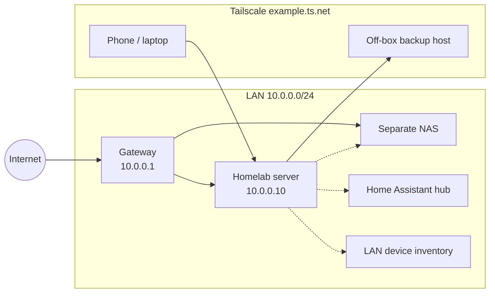

# Homelab Showcase

A sanitized portfolio of a self-hosted Ubuntu homelab: Docker Compose stacks,
storage layout, remote access, backups, monitoring, and security hardening.

This repository is intentional documentation for review (for example a
networking grant application). It describes the **current** live design with
placeholder addressing and no identifying details about a real home network.

## Hardware (model-level only)

| Role | Spec |
|---|---|
| Server | Ubuntu, 12th-gen Intel i5, 32GB-class RAM, NVMe root |
| GPU | NVIDIA GTX 10-series (optional acceleration for photo ML) |
| Data pool | mdadm RAID1 (two disks) plus extra disks pooled with mergerfs at `/srv/pool` |
| Stacks | Docker Compose under `/opt/stacks` |
| Off-box copy | Separate Linux host with a dedicated backup disk |

No hardware identifiers, MAC addresses, or disk capacities that fingerprint a specific machine.

## Network (placeholder)

Services are reachable on the LAN and over Tailscale (mesh VPN). Addresses
below are examples only.



See [diagrams/network.md](diagrams/network.md) for the same diagram and notes.

## What runs here

| Stack | Purpose |
|---|---|
| [Immich](stacks/immich/) | Photo library + ML |
| [PhotoPrism](stacks/photoprism/) | Alternate photo browser / originals index |
| [Paperless-ngx](stacks/paperless/) | Document archive |
| [Vaultwarden](stacks/vaultwarden/) + Caddy | Password manager (HTTPS on LAN) |
| [ntfy](stacks/ntfy/) | Push alerts to a phone |
| [Homepage](stacks/homepage/) | Dashboard |
| [Beszel](stacks/beszel/) + [agent](stacks/beszel-agent/) | Host / container metrics |
| [Uptime Kuma](stacks/uptime-kuma/) | Availability checks |
| [IT-Tools](stacks/it-tools/) | Small utilities |

Other devices on the same network (mentioned only generically): a separate NAS,
a Home Assistant hub, self-hosted remote management, and LAN device inventory.
Stacks for those live elsewhere and are not published here.

## Storage layout

```
/opt/stacks/          # compose files + per-stack .env (secrets, not in git)
/DATA/AppData/        # local app state (SQLite, Postgres data, configs)
/srv/pool/            # mergerfs pool (create policy mfs, minfreespace)
/srv/backup/          # mdadm RAID1 — nightly snapshots + DB dumps
```

Photo originals and large document trees may live on the separate NAS and be
mounted read/write into containers. App databases stay on local disk so SQLite
and Postgres are not hammering a network share.

## Security hardening (summary)

- Docker published ports filtered to LAN + Tailscale via `DOCKER-USER` (IPv4 and IPv6). Native ISP IPv6 has no NAT; without the IPv6 DROP, `[::]` docker-proxy ports would be public.
- Secrets in per-stack `.env` files (see `.env.example`); never committed.
- Vaultwarden signups disabled; admin token required.
- Nightly backups with an off-box write-only copy (rrsync, no deletes from the server).
- SMART + mdadm events → ntfy on the phone.

Details: [docs/hardening.md](docs/hardening.md), [docs/backups.md](docs/backups.md),
[docs/lessons-learned.md](docs/lessons-learned.md).

## Scripts

| Script | Role |
|---|---|
| [`scripts/server-prep`](scripts/server-prep) | Idempotent host prep (Docker, disks, firewall, alerts, …) |
| [`scripts/server-backup`](scripts/server-backup) | Nightly snapshot + Immich dump + off-box push |
| [`scripts/offbox-setup`](scripts/offbox-setup) | Prepare the off-box host (write-only rrsync receiver) |
| [`scripts/tailscale-serve`](scripts/tailscale-serve) | HTTPS via Tailscale `serve` for selected apps |

System unit snippets and helpers live under [`system/`](system/).

## Quick start (new machine)

1. Copy this tree to the server (or clone into `/opt/homelab-showcase`).
2. `sudo scripts/server-prep` (review steps first; disk wipe steps prompt).
   Then, as needed: `sudo scripts/server-prep alerts`,
   `POOL_DISKS=/mnt/disk1:/mnt/disk2 sudo scripts/server-prep pool`,
   and `sudo scripts/server-prep nfs` once a NAS export is ready.
3. For each stack: `cp stacks/<name>/.env.example stacks/<name>/.env`, edit, then
   `docker compose -f /opt/stacks/<name>/compose.yml up -d` (after linking or copying into `/opt/stacks`).
4. Point phone ntfy at the Tailscale HTTPS URL and subscribe to `${NTFY_TOPIC}`.
5. Run `scripts/tailscale-serve` once the Tailscale client is up.
6. After `server-prep backup`, run `scripts/offbox-setup` on a second host.

## License

MIT — see [LICENSE](LICENSE).
