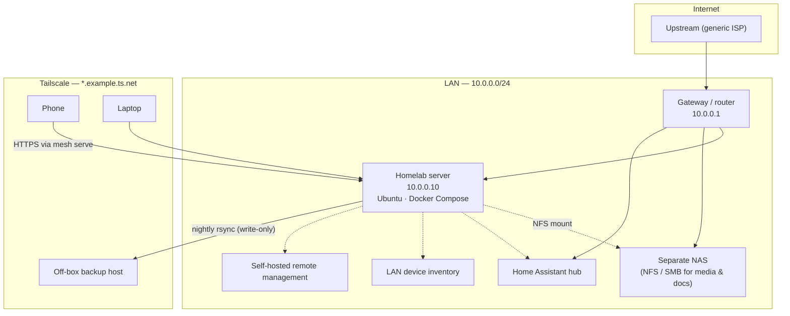

# Network diagram (placeholder addressing)

Addresses, hostnames, and the mesh DNS suffix are examples. Replace them for
your site. Do not commit real LAN or VPN identifiers to a public copy of this
repo.

## Conventions used in this showcase

| Placeholder | Meaning |
|---|---|
| `10.0.0.0/24` | Example LAN |
| `10.0.0.10` | Homelab server |
| `10.0.0.1` | LAN gateway |
| `example.ts.net` | Example Tailscale MagicDNS suffix |
| `${VAR}` | Value supplied at deploy time via `.env` |

Published Docker ports accept traffic from the LAN subnet and from the mesh
interface; WAN-facing traffic on the LAN NIC is dropped in `DOCKER-USER`
(see `system/docker-lan-filter.sh`).
